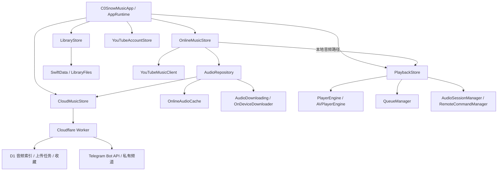

# Issue #15：实际对象、职责和播放链路

本次按 [Issue #15](https://github.com/C0verSnow/C0SnowMusic/issues/15) 核对代码。图中的 Service、Manager 是业务角色，不要求每个名字都新增一个类。以下记录实际实现、修复点与现有边界。

## 对象核对

| Issue 中的角色 | 实际对象和入口 | 职责及核对结果 |
| --- | --- | --- |
| C0SnowMusic / 业务协调 | `C0SnowMusicApp`、`AppRuntime`、`MusicRootView` | App 注入共享状态；AppRuntime 持有 SwiftData 容器、资料库和唯一播放器。 |
| MusicPlayer / PlaybackStore / PlaybackControl | `PlaybackStore`、`PlayerEngine`、`AVPlayerEngine` | 播放器只接收已取得的本地音频；播放、暂停、上下首、Seek 不调用 Telegram 或 D1。 |
| PlayQueue | `QueueManager`、`QueueEntry`、`RepeatMode`、`PlaybackSession` | 顺序、随机后续歌曲、列表循环和单曲循环；队列条目有独立身份，同一歌曲可以重复。持久队列恢复过滤已删歌曲且保持静音。 |
| AudioSession / 锁屏 / AirPlay | `AudioSessionManager`、`RemoteCommandManager`、`AirPlayView` | 后台类别、中断、耳机断开、系统遥控和 Now Playing；AirPlay 由系统路由选择器处理。 |
| YouTubeService / SearchAPI | `YouTubeMusicClient`、`OnlineMusicStore`、`OnlineTrack` | 搜索歌曲、视频、艺人、专辑、歌单，处理分页；搜索结果不等于已经下载的音频。旧 `YouTubeSearchClient` 仍提供视频 ID 和页面解析工具。 |
| PlaylistAPI / ArtistAPI / AlbumAPI | `YouTubeMusicClient.browse/collectionItems`、`MusicCollectionView` | 通过 browse ID 取得集合和分页；同一个集合页面展示歌单、艺人和专辑，没有为每种类型重复创建网络服务。 |
| VideoAPI / AudioExtractor | `OnlineTrack`、`OnDeviceDownloader`、`c0snow_downloader.py` | 卡片提供视频 ID、标题、作者、时长和封面；手机内串行调用 yt-dlp，获取原生 M4A，再由 AVFoundation 重新封装。 |
| AudioRepository / 音频获取协调 | 新增 `AudioRepository`、`AudioDownloading`、`ResolvedAudio` | 统一本地缓存、Worker 下载、手机提取顺序；向业务层返回本地路径和可选云端错误。下载器接口隔离外部提取服务，实际缓存验证不替换。 |
| TelegramService / Uploader / Retriever | `worker/index.js` 的 `telegram`、`upload`、`content`、`webhook` | Bot Token、频道、File ID、Message ID 全留 Worker；App 仅使用设备密钥与 Worker 通信。 |
| CloudflareService / API 网关 | `CloudMusicStore`、`worker/index.js` 的 `route/authenticate` | App 的仓库会话与 HTTP 接口；Worker 校验鉴权、路由请求并代理音频。 |
| D1Database / AudioStorage | `worker/migrations/0001_music.sql`、`0002_favorite_snapshots.sql` | 歌曲与音频分表，通过关联表连接 Telegram 文件；保存哈希、文件状态、上传任务、收藏、播放次数。 |
| SyncManager / 失败重试 | `OnlineMusicStore.prepare` 后台任务、`CloudMusicStore.upload/syncYouTubeFavorites`、Worker `upload_jobs` | 先取得本地可播放文件，再后台补传并登记 D1；收藏用完整快照提交。明确失败遵守重试期限，结果不确定的上传须核对回执后才能重发。 |
| LibraryManager / LocalDatabase | `LibraryStore`、`LibraryFiles`、`AudioImportService`、SwiftData 模型 | 本地 Song、Album、Artist、Playlist、PlaylistItem、PlaybackSession 与独立音频副本；不参与第三方鉴权。 |
| Favorites | `Song.isFavorite`、`OnlineMusicStore.liked`、Worker `favorites` | 本地歌曲收藏与 YouTube 收藏分别管理；账户歌单、专辑收藏列表来自 YouTube 音乐库；取消云端收藏保留音频。 |
| CacheManager | `OnlineAudioCache`、`CachedAudio` | 500 MB 文件缓存、按完成时间淘汰、元数据旁文件；永久资料库副本不参与淘汰。播放器清除失效临时引用。 |
| AccountManager | `YouTubeAccountStore`、`YouTubeLoginView`、`CloudMusicStore` | YouTube 网页会话与仓库连接分别存 Keychain，不把 Google 身份 OAuth 当作 YouTube Cookie 会话。 |
| UserInterface | `HomeView`、`SearchView`、`MusicCollectionView`、`LibraryView`、`PlaylistsView`、`NowPlayingView`、`MiniPlayerView`、`SettingsView` | UI 使用共享状态；艺人、专辑和歌单共用集合页面。 |

## 实际依赖

YouTube 音乐信息查询由 App 的 YouTubeMusicClient 承担。D1 按已知视频 ID 查询音频，不需要再让 Worker 调用 YouTube 搜索。元数据和音频文件保持分离。

## 播放流程及修复

1. 用户选中 OnlineTrack；AudioRepository 先查 OnlineAudioCache，命中直接返回，前台不访问仓库或提取器。
2. 缓存缺失且已连接仓库时，CloudMusicStore 按 YouTube source ID 或 Telegram track ID 查询 Worker；Worker 读 D1 并从 Telegram 交付完整音频。
3. 云端取得的音频经过真实音轨与可播放性检查，存入缓存后才交给播放器。无音频、包含视频轨或不可播放的下载不会进入缓存。
4. YouTube 曲目在云端未收录、文件失效、待处理、超限或请求失败时，继续尝试手机提取。此前云端错误会直接终止，导致有 YouTube 来源也无法重建本地音频；现在保留云端错误并继续正常流程。取消任务立即停止，不把取消当作回退信号。
5. Telegram-only 曲目没有 YouTube 来源，云端缺失时明确失败。缓存命中时仍可播放；后台仅记录播放，不再把 Telegram ID 发送给只接受视频 ID 的上传接口。
6. 本地文件就绪后启动共享 PlaybackStore；保存到资料库时仍通过原导入事务复制一份独立音频。
7. YouTube 曲目后台核对仓库并补传。Worker 以真实音频 SHA-256 去重，取得 Telegram 回执后写入文件索引；后台失败不会撤销已经开始的本地播放。
8. 自动淘汰或系统删除缓存后，下载收尾和缓存页刷新会清掉播放器中对应的临时 Song、URL 与队列引用。此前只有手动删除处理这一关系，下载另一首歌可能留下已不存在的播放路径。永久资料库副本保持独立。

## 保留的现有边界

- App 先下载完整音频再本地播放；Worker 的 Range 接口不等于 App 已实现远程边播边下。
- 标准 Bot 音频交付上限 20,000,000 字节；超限 YouTube 曲目可以走手机提取，Telegram-only 大文件仍需未来的 Local Bot API 交付服务。
- 当前后台补传跟随本次操作，不是跨 App 重启持续运行的下载队列。明确失败可以下次操作重试；结果不确定必须按现有回执核对流程处理，不能盲目重复上传。
- 本地资料库支持多首播放队列；在线卡片当前一次准备并播放一首。临时缓存歌曲不作为 SwiftData 持久歌曲恢复；手动下载到资料库后走持久队列。
- 本地收藏模型是歌曲收藏，YouTube 专辑和歌单收藏列表来自账户音乐库，不新增另一套本地专辑或歌单收藏模型。
- 按 Issue 明确要求，白色风车（周杰伦）、第57次取消发送（菲菲公主）、还是会想你（林达浪）的真机播放测试继续搁置，等待用户指令。本轮自动测试使用 CI 合成音，不代表三首真实歌曲验收通过。

## 参考与验证

本轮已在 GitHub 检索并复核 [yt-dlp](https://github.com/yt-dlp/yt-dlp) 与 [ytmusicapi](https://github.com/sigma67/ytmusicapi)。2026-11-17 查询快照：前者 208,509 stars、Unlicense、最近推送 11 月 17 日；后者 3,123 stars、MIT、最近推送 11 月 12 日。还读取了 [yt-dlp 贡献者回复](https://github.com/yt-dlp/yt-dlp/issues/18053#issuecomment-6885600468) 与 [ytmusicapi 作者回复](https://github.com/sigma67/ytmusicapi/issues/1030#issuecomment-6818691556)，不只依赖 star 数判断维护情况。

继续采用现有职责划分：ytmusicapi 提供音乐信息接口的协议参考，依赖 HTTP；yt-dlp 提供音源提取，依赖现有手机 Python / EJS / WebKit 运行时。前者不能替代下载引擎，后者不能替代资料库或云端存储；网页会话和网站变动仍是已知限制。没有添加新依赖，没有复制上游实现。原有方案比较、版本和许可见 [在线调研](ONLINE_MUSIC_RESEARCH.md) 与 [仓库调研](TELEGRAM_MUSIC_RESEARCH.md)。

回归覆盖见 `MusicAppTests/AudioRepositoryTests.swift`：本地命中、云端命中、无仓库、六类云端缺失或失败、Telegram-only 失败、取消、Telegram 播放不误补传、自动淘汰后保留永久副本。使用真实音频、缓存、SwiftData 和播放器，只替换外部 HTTP 与提取服务边界。编译与执行结果以 [测试记录](VERIFICATION.md) 和当前 PR 的远端 CI 为准；本地只做阅读、静态和差异检查。
