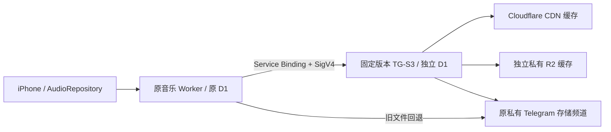

# TG-S3 存储升级

应用名是 **c0versnow music**，仓库是 [C0verSnow/c0versnowmusic](https://github.com/C0verSnow/c0versnowmusic)。现有 Bundle ID、Xcode 工程名、设备 Keychain 与数据目录保持原标识，覆盖安装可保留用户数据。

本次实际采用 [gps949/tg-s3](https://github.com/gps949/tg-s3)，固定源码提交 `82bff102498658fd462ad478229fc49cb2f44c47`。上游 README 声明 MIT，未提供独立 LICENSE；维护、鉴权、部署及大文件约束见 [源码调研](TG_S3_RESEARCH.md)。没有复制来源不明的实现。

## 实际链路



手机继续使用原音乐接口和设备密钥，本机优先播放缓存；没有新增手机凭证或把 S3/Bot 密钥放进 IPA。新音频经真实 PutObject 写入 `c0snow-audio/audio/<sha256>`，TG-S3 负责 Telegram Document 与对象索引。音乐 D1 保留歌曲、收藏、播放、音频哈希和任务，新增 `tg_s3_objects` 对象映射。

对象服务关闭 `workers.dev` 和预览地址，仅供音乐网关通过 Service Binding 使用。`TGS3_ENDPOINT` 作为签名 URL 使用；该地址不要求开放公网访问。S3 credential 仅有音乐桶的 readwrite 权限。复用原 Bot 和存储频道，但不注册上游 Mini App/Webhook，也不运行会覆盖 Webhook 的上游部署脚本。新对象首次完整读取可回填 CDN/R2；64 KiB 至 20 MiB 的文件可进入 R2。R2 是缓存，不是完整备份。

## 迁移与失败恢复

- 新写入由 `AUDIO_STORAGE_BACKEND=tg-s3` 选择。上传先 HEAD；已有相同哈希与长度对象直接补齐音乐索引，否则使用 `If-None-Match: *` PUT，412 后重新 HEAD。成功前不标记 ready。
- `s3_<sha256>` 任务与旧 `upl_<sha256>` 分开。回执不明时保留 uncertain；下一次先查实际对象，存在时登记成功，不盲目重复上传。对象仍不存在则由管理员核对，通过原 `/api/jobs/<id>/reconcile` 明确处理。上游自身存在 AbortError 重试，本版不承诺严格恰好一次。
- 管理员可调用 `POST /api/files/<sha256>/migrate`，仍需设备密钥与 `X-Admin-Key`。迁移读取并核对旧音频字节、大小和 SHA-256，向对象服务复制，成功才登记映射。原消息与原表记录保留；失败不撤销旧 ready 音频。
- 读取优先 TG-S3；映射对象返回 404 后标记该映射 missing，再尝试旧 Telegram 副本。没有旧副本时标记音频 missing，手机沿原 AudioRepository 规则处理。一般网络故障不判定文件已经丢失。
- 对外内容响应仍为 `private, no-store`，支持完整 GET、HEAD、单段 Range 和 416。`X-Music-Storage: tg-s3` 可核对实际存储路径；缓存响应由上游 `X-Cache` 区分。
- `/send` 对新 Document 重新取得音频字节，以 Telegram Audio 发往既有授权接收人；不能把 Document file_id 当作 Audio file_id。旧文件仍用原发送方式。

本次保留音乐接口 `20_000_000` 字节上限，没有部署 VPS、Local Bot API 或大文件处理器，也不启用上游带删除行为的 cron。不能据此宣称 2 GB 已可用。

## 验证与部署

本地只做源码、语法、配置和差异检查，不运行构建或测试。既有 `build-player.yml` 的 music-api job 在远端拉取固定上游源码，用 `storage/tg-s3/package-lock.json` 固定 Wrangler 4.160.1 并 `npm ci`，生成真实上游与音乐网关 bundle。集成测试把真实上游 bundle、真实音乐 API、SQLite 和 MP3 字节串起来，仅替换外部 Telegram HTTP 及 Cloudflare 缓存运行环境。覆盖 SigV4、私有桶、PUT/HEAD/GET、412、去重、CDN/R2、Range、回执丢失恢复、限流、旧文件迁移/回退、收藏保留和发送格式。

上游固定提交的 package.json 要求 Wrangler 4，但其锁文件仍锁定 Wrangler 3，直接 npm ci 会失败；本仓库独立锁定远端打包工具，不修改固定上游源码。

远端测试成功才上传 `tg-s3-worker` 产物，包含 bundle、schema、固定提交说明与逐文件 SHA-256。下载时先核对 GitHub 归档摘要，再解压到忽略的 `Vendor/tg-s3/`；脚本继续核对文件摘要和固定提交。

已有资源：独立 D1 `c0snow-tg-s3`、私有 R2 `c0snow-tg-s3-cache`。新环境须先用现有 Wrangler 流程创建资源并更新配置 UUID，不能复用其他项目资源。

```sh
python3 scripts/configure_tg_s3.py deploy
python3 scripts/configure_tg_s3.py migrate
python3 scripts/configure_tg_s3.py check
```

部署脚本复用根目录 mode 0600 的 `.env`，生成并保留 S3 credential，初始化对象库和私有桶，先部署对象服务，再应用音乐 D1 新迁移和部署网关。所有部署显式 `--no-bundle`，仅上传远端产物；secret 和含 credential 的 SQL 临时文件为 0600，敏感输出不打印。部署前后核对原 Webhook 未变。迁移脚本逐个文件复制，再通过原音乐内容接口下载并核对完整 SHA-256，不删除旧消息。

回退新写入可把 `AUDIO_STORAGE_BACKEND` 改为 `telegram` 并重新部署已验证网关。保留 S3 binding、密钥和映射以读取已写入的新文件；不要直接回退到不认识 S3 映射的旧版网关，也不要删除数据库、对象或 Telegram 消息。

提交时尚未部署、迁移或完成三首歌真机验收。远端运行、部署版本和真机结果另记 [验收记录](VERIFICATION.md)；PR #16 保持草稿，真机通过前不合并。
